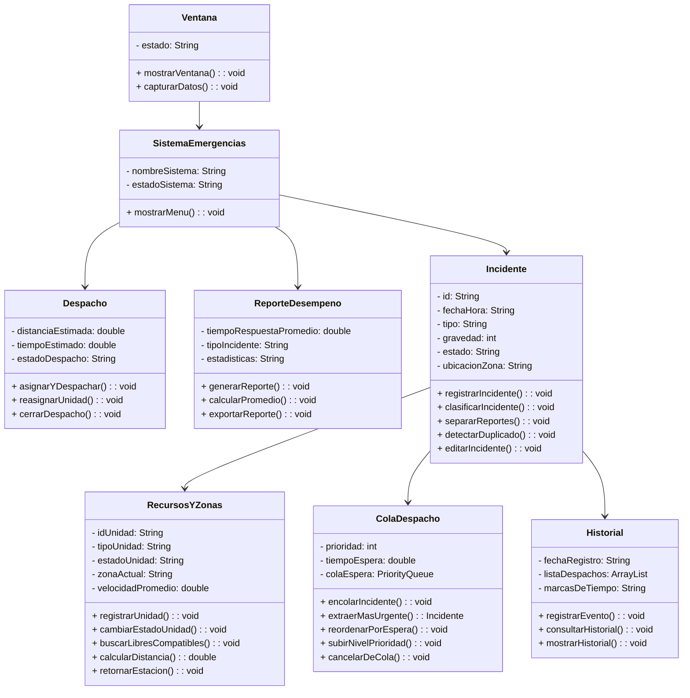

# Sistema de Despacho y Gestión de Emergencias

> **Asignatura:** Programación III – Estructuras de Datos y Algoritmos en Java  
> **Docente:** Ing. Paulo Guerra T.  
> **Ubicación:** Quito, Ecuador  
> **Entrega:** Progreso 1 – Análisis, diseño y selección de la solución

---

## 📌 Contexto y Formulación del Problema

En situaciones de emergencia, el tiempo transcurrido entre la recepción del reporte y la llegada de los recursos a la escena es crítico; en Ecuador, el estándar de respuesta óptimo para una ambulancia es de máximo **15 minutos**. 

A finales de septiembre de 2024, tras la transición de responsabilidades operativas hacia el ECU 911 en la zona de Samborondón/Guayaquil, el flujo de llamadas aumentó de 3.500 hasta más de 9.000 llamadas diarias, experimentando incrementos de hasta un 230% en emergencias procesadas. Este incremento expuso problemas críticos como:
- Sobrecarga en operadores de llamadas y despachadores.
- Saturación de líneas por incidentes no críticos (averías de luminarias, cortes de energía, baches).
- Tiempos de despacho y respuesta prolongados debido a congestión vehicular, dificultad para ubicar direcciones y falta de sincronización interinstitucional.

### Propósito del Software
Proveer una solución algorítmica orientada a ordenar la atención ante una sobredemanda: priorizar incidentes según nivel de urgencia y tiempo de espera, y asignar de forma eficiente y rápida las unidades de respuesta más convenientes basándose en tiempos estimados entre zonas geográficas.

---

## 🎯 Alcance del Sistema y Reglas del Negocio

El sistema se enfoca en la **clasificación, priorización, asignación algorítmica y monitoreo** de unidades de respuesta (ambulancias, bomberos, patrullas policiales). 

> **Nota de alcance:** El software no realiza trazado de rutas viales sobre mapas; la estimación de tiempos de respuesta se gestiona a través de una matriz/tabla de tiempos preestablecida entre zonas y estaciones.

---

## 🧩 Módulos Funcionales y Responsables

| Módulo | Responsable(s) | Propósito y Operaciones Principales |
| :--- | :--- | :--- |
| **M1: Recepción y Clasificación de Incidentes** | Juan Diego Hurtado | Registra llamadas entrantes, clasifica por tipo y gravedad, filtra reportes que no corresponden a emergencias (gestión ciudadana) y detecta llamadas duplicadas. |
| **M2: Priorización y Cola de Despacho** | Lucas Aguinaga | Administra la cola prioritaria de despacho. Soporta niveles de prioridad (1 a 4, siendo 1 riesgo vital inmediato). Si un incidente supera el tiempo máximo de espera, promueve su nivel (*aging*). Política FIFO para desempate en igualdad de prioridad. |
| **M3: Unidades, Estaciones y Zonas** | Santiago Paredes | Administra los recursos (patrullas, ambulancias, motobombas), estaciones y zonas. Indexa unidades disponibles por tipo y zona para agilizar las consultas de disponibilidad. |
| **M4: Asignación y Despacho** | Jose Mendez | Retira incidentes de la cola, evalúa unidades compatibles y disponibles más cercanas (menor tiempo estimado), formaliza el despacho y gestiona reasignaciones si una unidad asignada falla. |
| **M5: Seguimiento y Reportes** | Remmy Arevalo (Ops. 1 y 3) Cristopher Espinoza (Ops. 2, 4 y 5) | Registra marcas de tiempo y auditoría de eventos. Genera métricas de rendimiento (tiempo promedio de respuesta por zona/tipo) y exporta resúmenes estadísticos. |

---

## 🏗️ Arquitectura y Modelo de Clases (UML)

El diseño orientado a objetos contempla las siguientes clases principales:

---

## ⚖️ Análisis y Selección de Estructuras de Datos

Se evaluaron dos alternativas para los componentes críticos de **priorización de incidentes** y **búsqueda de unidades disponibles**:

| Criterio | Alternativa A (Seleccionada) | Alternativa B |
| :--- | :--- | :--- |
| **Estructuras Empleadas** | `PriorityQueue` (Heap Binario) | Lista lineal ordenada por prioridad + Lista simple de unidades |
| **Inserción de incidentes** | $\mathcal{O}(\log n)$ | $\mathcal{O}(n)$ |
| **Extracción del más prioritario** | $\mathcal{O}(\log n)$ | $\mathcal{O}(1)$ |
| **Búsqueda de unidades libres** | $\mathcal{O}(1)$ tiempo promedio para filtrar candidatos por clave (zona/tipo) | $\mathcal{O}(U)$ donde $U$ es la cantidad de unidades en la flota |
| **Complejidad Espacial** | $\mathcal{O}(n + U)$ (requiere memoria adicional para el índice hash) | $\mathcal{O}(n + U)$ (menor consumo auxiliar) |
| **Ventajas** | Altamente escalable; eficiente para un alto flujo continuo de llamadas y actualizaciones. | Lógica de implementación simple; sin costo de sincronización de índices. |
| **Desventajas / Retos** | Exige mantener sincronizado el índice ante cualquier cambio de estado de una unidad. | Costosa degradación temporal a medida que crecen los incidentes en cola y la flota de unidades. |

### Fundamentación Técnica
Se seleccionó la **Alternativa A** debido a que los sistemas de despacho operan en tiempo real bajo escenarios de estrés operativo. La combinación de un montículo binario (`PriorityQueue`) con un índice hash garantiza tiempos logarítmicos $\mathcal{O}(\log n)$ en la gestión de incidentes y accesos en tiempo constante $\mathcal{O}(1)$ para el filtrado de unidades, evitando búsquedas exhaustivas lineales $\mathcal{O}(U)$ al despachar.

---

## 👥 Integrantes del Equipo

* **Lucas Aguinaga**
* **Santiago Paredes**
* **Juan Diego Hurtado**
* **Jose Mendez**
* **Remmy Arevalo**
* **Cristopher Espinoza**

---

## 📚 Referencias Bibliográficas

- El Universo. (2024, septiembre 28). *¿Qué pasará con Segura EP ahora que no receptará ni coordinará llamadas de emergencia en Guayaquil?* https://www.eluniverso.com/guayaquil/comunidad/que-pasara-con-segura-ep-ahora-que-no-receptara-ni-coordinara-llamadas-de-emergencia-en-guayaquil-nota/
- Mena Medrano, L. (2023). *Determinación de factores y propuesta de mejora para reducir el tiempo óptimo de respuesta en emergencias de la ambulancia de atención prehospitalaria del Hospital General del Sur de Quito IESS durante el periodo enero - diciembre 2022* (Tesis de maestría, UDLA). http://dspace.udla.edu.ec/bitstream/33000/15358/1/UDLA-EC-TMSP-2023-103.pdf
- Primicias. (2024, octubre 16). *ECU-911 registra desborde de llamadas tras retiro de central de emergencias al Municipio de Guayaquil*. https://www.primicias.ec/guayaquil/ecu-911-alertas-respuesta-municipio-seguraep-central-llamadas-81208/
- Viracocha-Chango, C. G., & Zambrano-Santos, R. O. (2026). *Evaluación de la calidad del tiempo de respuesta en la atención de emergencias médicas del Servicio de Salud Móvil*. Código Científico Revista De Investigación, 7(E1), 2406-2424.
